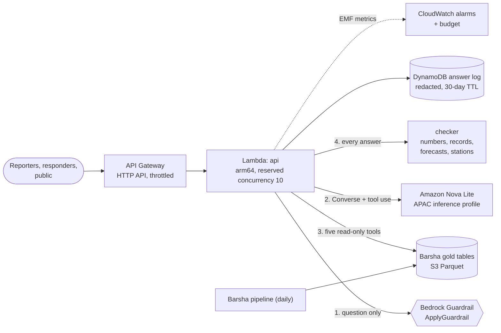

# Sodhnus (सोध्नुस्, "please ask"): rainfall questions about Nepal, answered only from verified data

[](https://sodhnus-nepal-rain-assistant.onrender.com)

Sodhnus is a bilingual Nepali and English assistant on Amazon Bedrock for reporters, disaster responders and anyone asking "how much did it actually rain?". It answers from my [Barsha](https://github.com/bikash9cmd/barsha-nepal-monsoon-lakehouse) rainfall tables and nothing else. A language model (Amazon Nova Lite) understands the question and writes the answer, but it can only get facts through five read-only tools, and every number in its answer is checked against what those tools returned before anyone sees it. It refuses to forecast.

```text
$ python -m sodhnus ask "How unusual was the rain in Kathmandu on असोज १२, 2081?"
Kathmandu Airport recorded 194.1 mm on 28 September 2024 (12 Asoj 2081 BS): very heavy rain. That is the
wettest day in its record since 1976 (the previous highest was 191 mm on 10 July 1994). Over 3 days, 291.1 mm fell.

$ python -m sodhnus ask "२०८१ असोज १२ मा कहाँ सबैभन्दा धेरै पानी पर्यो?"
२०८१ असोज १२ (२०२४-०९-२८) मा सबैभन्दा धेरै पानी: भैरहवा १९४.३ मिमि, काठमाडौं विमानस्थल १९४.१ मिमि, धनकुटा १७३ मिमि, ...

$ python -m sodhnus ask "How much rain fell in Kathmandu on 15 July 2001?"
Kathmandu Airport has no usable rainfall amount for 15 July 2001 (31 Asar 2058 BS). Its weather codes say it
rained, so this was not a dry day.

$ python -m sodhnus ask "bholi ktm ma pani parchha ki?"
म पहिले नापिएको वर्षाको मात्र जानकारी दिन्छु, त्यसैले आगामी मौसम भन्न सक्दिनँ। पूर्वानुमान र बाढी सूचनाका लागि
जल तथा मौसम विज्ञान विभागको पूर्वानुमान (mfd.gov.np) र बाढी पूर्वसूचना (hydrology.gov.np) हेर्नुहोस्।
```
*(Real output of the offline backend on the real data. The Bedrock backend calls the same tools and goes through the same checks.)*

## The problem

After every big storm in Nepal, the same questions arrive: how much rain fell, has that ever happened before, where was it worst? Newsrooms and response teams answer them under deadline, and the answers that go out are often wrong in ways that matter. A day with no reading gets reported as dry. A town 70 km from the nearest gauge gets that gauge's number. "Heaviest in 100 years" gets written where the data says "1 in 100 rainy days".

A chatbot makes this worse if it is built the obvious way. A language model will answer "how much rain fell in Chitwan on Asoj 12?" fluently, with a plausible number, in either language. That is the exact failure I wanted to design out.

I built Barsha to make Nepal's rainfall record trustworthy. Sodhnus is the part people talk to, and its job is to make sure the fluency never outruns the data.

## What it does differently

| Risk | What Sodhnus does |
|---|---|
| The model invents a number | Every number in an answer must come from a tool result or from the question. If not, the model gets one rewrite with the reasons, then a template answer built from the same tool results replaces it. |
| A real number is attached to the wrong thing (the old record quoted as today's rain) | Each tool result has one required figure, the one that answers the question, and the answer must contain it. |
| "Record" or "unprecedented" without evidence | Record language is only allowed when a tool found a record. |
| Forecasts | Refused in English, Nepali and romanised Nepali before any model runs, and again by a Bedrock Guardrail denied topic; future-tense answers are rejected by the checker. |
| Missing days read as dry | The tool returns no amount for a missing day, and says when weather codes show it rained. |
| A town without a gauge | The nearest station is used only within 40 km, and the answer says which station and how far. Beyond that, no number. |
| Dates in Bikram Sambat | असोज १२, Asoj 12, आश्विन १२ and 12 Asoj 2081 all resolve to 28 September 2024; with no year, the most recent such day is used and the answer says so. |
| Stale data | Every answer carries the date the data runs to. The public feed stopped on 24 August 2025, and Sodhnus says so instead of pretending to be live. |

## Results

**Evaluation set:** 60 questions in English, Nepali and romanised Nepali, written before tuning and split into a dev set (35) and a holdout set (25) that I didn't tune on. Expected values come from DuckDB queries straight on the parquet files, not from the tools. Details: [docs/EVALUATION.md](docs/EVALUATION.md).

| Backend | Dev | Holdout |
|---|---:|---:|
| Rules (offline, no model) | 35/35 | **24/25** |
| Amazon Nova Lite on Bedrock | not run yet (no Bedrock access in my build environment; `make eval-bedrock`) | |

**The checker:** 350 wrong answers made by mutating correct ones the way models go wrong.

| Mutation | Caught |
|---|---:|
| Off by 1, by 3, by 10%, x10, transposed digits | 189/190 |
| A forecast added | 47/47 |
| A station nobody looked up | 44/44 |
| A real number from the wrong field | 34/35 |
| An invented "record" | 27/34 |
| **All** | **341/350 (97%)** |

Right answers rejected: 0 of 47 template answers, 1 of 15 hand-written model-style paraphrases ("nearly 200 mm" for 194.1, rejected on purpose).

### What I'd tell an interviewer about these numbers

- **The 24/25 is the offline rules backend on questions I wrote.** It says the tools, dates, places, refusals and checker work. It says nothing about how Nova Lite routes real people's questions; that number doesn't exist yet, and the harness to produce it is one command away once the stack is deployed.
- **The checker went from 0/35 to 34/35 on swapped numbers** after its first measurement. Membership checking alone ("is this number anywhere in the tool results?") cannot see the old record quoted as today's rain. The fix was the required-figure check ([bug #10](docs/CHALLENGES_AND_BUGS.md#10-the-checker-couldnt-see-a-real-number-in-the-wrong-place)).
- **The remaining misses are real.** Small amounts collide with dates: 15 mm on 15 June passes even when mutated to 14. Those are in the report, not hidden.

## Architecture



One Lambda, no vector database, no agent framework. The model's only access to data is five typed tools (`rain_on_day`, `wettest_days`, `monsoon_total`, `rain_across_stations`, `station_coverage`) that take a place and a date and return a small dict. The whole design and the reasoning behind it: **[docs/ARCHITECTURE.md](docs/ARCHITECTURE.md)**.

## Engineering documents

| Document | What's in it |
|---|---|
| [Architecture](docs/ARCHITECTURE.md) | AWS and local diagrams, the life of one question, why each piece exists, security, scaling |
| [Alternatives considered](docs/ALTERNATIVES.md) | 10 decisions: tools vs text-to-SQL vs RAG, Nova Lite vs others, guardrail placement, own checker vs contextual grounding, Bedrock Agents, Lambda vs containers, region, and when I'd switch |
| [What breaks](docs/FAILURE_MODES.md) | 14 failure modes with detection, response and the test that covers each |
| [Cost](docs/COST.md) | About **$8.60 a month at 10,000 questions**; the guardrail, not the model, is the biggest line |
| [Evaluation](docs/EVALUATION.md) | The question set, scoring, the checker's mutation test, and what hasn't been measured |
| [Challenges and bugs](docs/CHALLENGES_AND_BUGS.md) | 16 real problems hit while building this |
| [Responsible AI](docs/RESPONSIBLE_AI.md) | Intended use, who the errors hurt, language coverage, privacy |

## How it maps to the AWS Well-Architected pillars

| Pillar | In this project |
|---|---|
| Operational excellence | IaC (SAM); one structured log line per answer with backend, refusal, fallback and tokens; the evaluation runs in CI |
| Security | Least-privilege IAM: read one S3 prefix, invoke one model, use one guardrail, write one table; prompt-injection screening; read-only tools that drop unknown arguments; no SQL from the model |
| Reliability | Every Bedrock failure (throttling, timeout, tool loop, failed fact check) falls back to a correct template answer; the gold tables are cached and reloaded on ETag change |
| Performance efficiency | Tables held in memory (320 KB of Parquet, 0.3 s to load); offline answers in ~30 ms; one Converse round trip for most questions |
| Cost optimisation | Nova Lite (13x cheaper than Nova Pro here); guardrail applied once to the question instead of to every call (4.2x cheaper); no vector store ($175/month avoided); metrics without dimensions; throttle and concurrency cap against denial-of-wallet |
| Sustainability | No idle compute; the smallest model that does the job; refusals and failures cost no tokens |

## AWS AI Practitioner topics this covers

Foundation model selection and cost trade-offs; prompt engineering (system prompt, greedy decoding for tool use); tool use / function calling with the Converse API; why not RAG for numeric tables; Bedrock Guardrails (denied topics, content filters, prompt-attack filter, PII); hallucination detection; evaluating a GenAI system with a held-out set and adversarial tests; responsible AI (transparency, refusal design, language fairness, privacy); and security for LLM apps (prompt injection, least privilege, denial-of-wallet).

## Try it live

**[https://sodhnus-nepal-rain-assistant.onrender.com](https://sodhnus-nepal-rain-assistant.onrender.com)**

Ask how much it rained somewhere in Nepal and how unusual it was, in English, Nepali or romanised Nepali, with Bikram Sambat dates. Ask it to forecast and watch it refuse.

It runs on a free server that sleeps when nobody is using it, so the first visit can take a minute to wake up. Everything runs offline: no API keys, no cloud account.

To run the same page locally: `pip install -r requirements-app.txt` and then `streamlit run app.py`.

## Run it

**With Python 3.12+**, no AWS account needed (the rules backend runs offline on the data snapshot):

```bash
make setup && source .venv/bin/activate
make demo            # the questions above
python -m sodhnus ask "Pokhara monsoon 2081" --debug   # also prints tool calls, results and checks
make serve           # HTTP API on http://localhost:8000 (POST /ask, POST /feedback, GET /health, /docs)
make eval            # the 60-question evaluation
make checker-eval    # the 350-mutation checker test
make test            # 59 tests, including the Bedrock path against a scripted Converse stand-in
```

**With Bedrock** (needs credentials and Nova Lite access in your region):

```bash
SODHNUS_BACKEND=bedrock python -m sodhnus ask "How unusual was the rain in Pokhara on असोज १२?"
make eval-bedrock
```

**On AWS:** [infra/README.md](infra/README.md) (`sam build && sam deploy --guided`, pointing at Barsha's bucket).

## Repository layout

```text
sodhnus/
  dates.py        Bikram Sambat and AD dates in English, Nepali and romanised Nepali
  places.py       station gazetteer, Nepali postpositions, nearest station within 40 km
  data.py         Barsha's gold tables from a folder or S3, cached and reloaded on change
  tools.py        the five read-only tools and their Bedrock tool specs
  guard.py        question screening (forecast, impact, safety, injection) and redaction
  bedrock.py      Converse loop with tool use; ApplyGuardrail on the question
  checker.py      every answer against the tool results
  answer.py       template answers in English and Nepali (offline backend and fallback)
  router.py       the offline backend's question parser
  assistant.py    guard -> backend -> checker -> rewrite -> fallback
  api.py          FastAPI (local); aws/handlers.py serves the same routes on Lambda
eval/             question sets, reference SQL, scorer, checker mutation test, results
infra/            SAM template (API, Lambda, Guardrail, DynamoDB, alarms, budget), Dockerfile, deploy guide
scripts/          cost model
tests/            59 tests; Lambda handlers on mocked S3 and DynamoDB
docs/             the documents above
data/             a snapshot of Barsha's gold tables (320 KB)
```

## Honest limits

- **The model path has not run against Bedrock yet.** My build environment had no Bedrock access. The Converse loop, tool calls, rewrite and every fallback are tested against a scripted stand-in that returns real Converse response shapes, and the template answers are measured. The first thing I'd do with an AWS account is `make eval-bedrock`.
- **The AWS stack is lint-checked and the handler is tested against mocked AWS, but not deployed.**
- **It is only as right as Barsha.** Barsha publishes a 2014 monsoon total of 277 mm for Dhankuta, built from 62 "complete" days that read 0.00. Sodhnus now flags totals under half the usual as suspicious, but a subtler upstream error would be repeated.
- **Nepali and English only.** Maithili, Bhojpuri and Tharu speakers in the Terai, where floods hit hardest, are not served.
- **Sixteen stations.** Most places in Nepal have no gauge within 40 km, so the honest answer is often "no number".

## Data

NOAA Global Surface Summary of the Day for Nepal (AWS Open Data), cleaned and quality-flagged by Barsha. Snapshot details and lineage: [data/README.md](data/README.md).

## License

MIT. The data remains under its source's terms.
