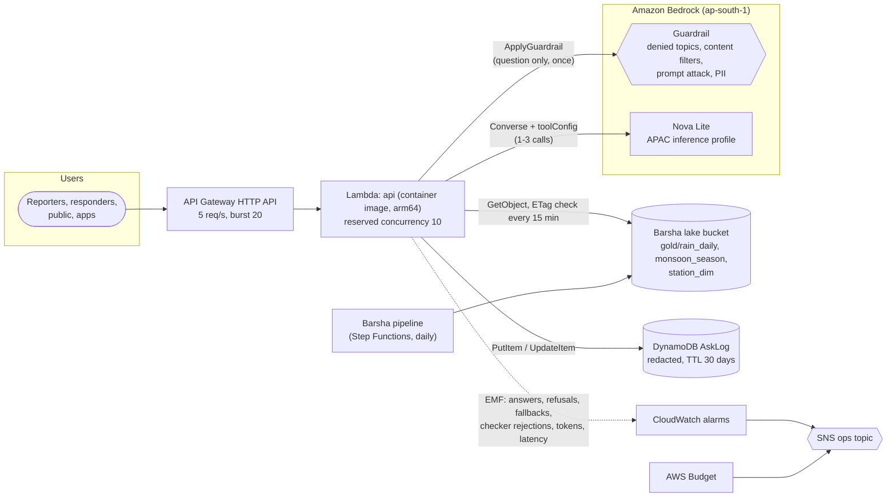
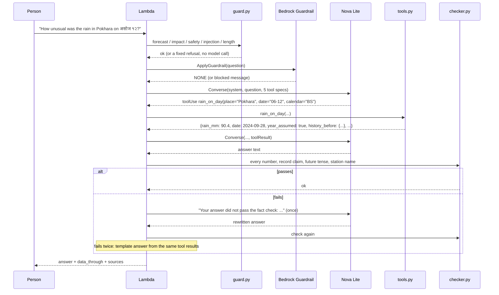
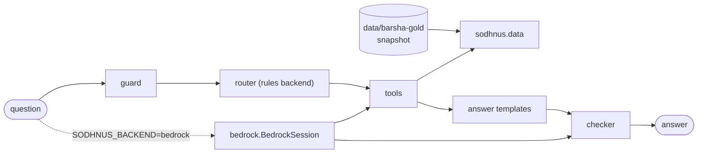

# Architecture

## The shape of the problem

Before picking services I wrote down what the workload is, because for a GenAI app the cost and the risk follow from it.

| Property | Value | Consequence |
|---|---|---|
| Data | 3 small tables, 320 KB of Parquet, updated once a day by Barsha | Hold it in memory. No database, no vector store, no search cluster. |
| Questions | Bursty: near zero most days, hundreds after a storm | Scale to zero; cap concurrency and request rate so a burst (or abuse) can't run up a model bill. |
| What an answer contains | Numbers, dates, station names | The danger is a wrong number, not a rude sentence. Check numbers deterministically. |
| Languages | Nepali (Devanagari), romanised Nepali, English, often mixed | Every check that matters must work in all three, offline and in tests. |
| Dates | Bikram Sambat in speech, Gregorian in the data | A calendar conversion step with the spellings people actually use. |
| Harm from errors | A responder treats a missing day as dry; a reporter prints a false record; someone acts on a "forecast" | Refuse forecasts, label missing and suspect data, never substitute a far-away station. |

Those rows are why Sodhnus is one Lambda with tool use and a checker, rather than a RAG pipeline or an agent framework.

## AWS deployment

Everything is in [`infra/template.yaml`](../infra/template.yaml) (AWS SAM).

## The life of one question

## Why each piece is there

**Tools, not SQL, not retrieval.** The model never sees a table. It calls one of five typed functions with a place and a date and gets back a small dict of facts (median ~760 characters). The tools decide what can be said: a missing day comes back with no amount, a partial day with "at least", a suspect value labelled, a place beyond 40 km with no number at all. A model with SQL access could average the missing days as zeros; a retrieval system would hand it table fragments to do arithmetic on. Both are in [ALTERNATIVES.md](ALTERNATIVES.md).

**The checker is the core of the design, not the prompt.** The system prompt asks for the right behaviour, but prompts are requests. `checker.py` enforces four rules on every answer, whichever backend wrote it:

1. Every number must come from a tool result or the question (in Devanagari or ASCII digits, allowing the roundings a writer would use, and the BS form of any AD date the tools returned).
2. Each tool result's required figure (the day's rainfall, the season total) must appear, which catches a real number put in the wrong place.
3. Record language needs a tool that found a record.
4. No future tense; no station that no tool looked at.

A failed answer gets one rewrite with the reasons; a second failure is replaced by the template answer built from the tool results the model already fetched, so the person still gets the facts.

**Two backends behind one interface.** `rules` parses the question with `router.py` and writes the answer with `answer.py` templates; `bedrock` uses Nova Lite for both. They share the guard, the tools and the checker. The rules backend is what runs offline and in CI, and it is the fallback when Bedrock throttles, times out, loops on tools or fails the checker twice. A Bedrock outage makes the answers plainer, not wrong.

**The guardrail is applied once, to the question.** Attached to Converse, a guardrail is evaluated on the input and the output of every call, two or three calls per question, and it was the most expensive part of the system. `ApplyGuardrail` on the question alone is one text unit. The output side is covered by the checker, which is stricter about what matters here and costs nothing ([COST.md](COST.md)).

**Bilingual screening runs before the guardrail.** `guard.py` refuses forecasts, casualty and damage questions, safety advice and prompt-injection attempts in English, Nepali and romanised Nepali. I couldn't confirm that the guardrail's topic filters understand "bholi ktm ma pani parchha ki?", and these checks run in tests on every commit.

**The data is Barsha's, read-only.** The Lambda can `GetObject` on one prefix of Barsha's bucket and nothing else. The tables are loaded once per container (0.3 s for 320 KB) and reloaded when their ETags change, checked at most every 15 minutes. If Barsha's schema changes, loading fails loudly instead of answering from the wrong column.

**The answer log is for improving answers, not for surveillance.** Phone numbers and emails are redacted before storage (people paste them when a relative is in a flood area); items expire after 30 days; the log records which backend answered, whether the checker rejected anything and why, and the person's thumbs up or down from `POST /feedback`.

**Metrics without dimensions.** Six custom metrics with no dimensions cost $1.80 a month. My first version split seven metrics by backend, which would have been $8.40 a month, more than the model at 1,000 questions. Per-backend breakdowns come from Logs Insights over the same EMF lines.

**Spend is capped three ways.** HTTP API throttling (5 requests a second, burst 20), reserved concurrency of 10 on the function, and a token-spend alarm at 5 million input tokens a day, about 1,000 times a normal question. Plus a monthly budget alarm.

## Security

| Threat | Control |
|---|---|
| Prompt injection in the question | `guard.py` patterns; the guardrail's prompt-attack filter; and the blast radius is small by design: tools are read-only, take only declared arguments (unknown ones are dropped, tested with `sql="drop table ..."`), and the checker still gates the output |
| Injection through data | Tool results are Barsha's own typed values (numbers, dates, fixed station names); no free text from outside reaches the model |
| Data exfiltration | There is nothing private to exfiltrate: the data is public, and the log stores redacted questions only |
| Over-broad IAM | One S3 prefix (read), one DynamoDB table (put/update), one model (invoke), one guardrail (apply) |
| Denial of wallet | Throttling, reserved concurrency, `maxTokens` 500, at most 4 tool rounds and 1 rewrite per question, token alarm, budget |
| Question size | 400 characters; longer is refused before any model call |

## Local deployment (what runs in this repo today)

The CLI, the FastAPI app and the Lambda handler all call `sodhnus.assistant.ask`. `tests/test_bedrock_backend.py` runs the Bedrock path against `tests/fakes.ScriptedBedrock`, which returns real Converse response shapes (tool use, text, usage) and records every request; `tests/test_aws_handlers.py` runs the Lambda handler against mocked S3 and DynamoDB.

## Scaling: what changes at 10x and 100x

| Load | What breaks first | Change |
|---|---|---|
| 10x (100,000 questions a month) | Nothing structural. Cost goes to ~$66/month, mostly guardrail and model. | Raise the throttle; consider answering with the rules backend when it parses the question with confidence (no model call), which my eval set suggests covers most simple questions |
| A storm-day spike (hundreds a minute) | Reserved concurrency (10) and Bedrock on-demand quotas | Raise both deliberately; cache identical questions for a few minutes (the data changes daily) |
| Hundreds of stations (DHM's full network) | Tables grow ~20x, still a few MB in memory | Same design; the gazetteer and the 40 km rule matter more, not less |
| Hourly data, live during a storm | The daily gold tables | Barsha would need a streaming path; Sodhnus would need "data as of HH:MM" in every answer |
| Free text from responders (field reports) | Tools only cover measurements | A separate, clearly labelled retrieval tool over reports; the checker would need to treat report numbers as quotes, not facts |
